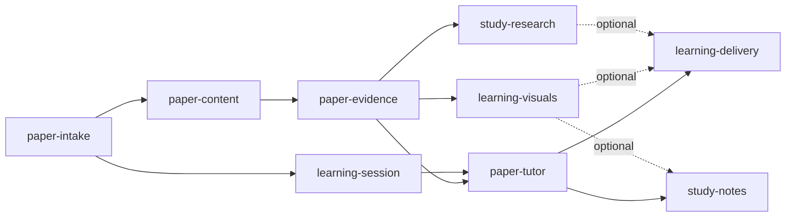

# Capability map: interactive paper learning

**Execution authorized — 17 October 2026.** The user requested research followed
by implementation, autonomous routine decisions, and questions deferred until
the implementation report. This authorizes the next iteration using the module
boundaries below; implementation decisions and verification are recorded in the
[iteration specification](docs/specs/paper-learning.md). Earlier review gates
are superseded by that explicit instruction, not silently bypassed.
Current code is preserved at `a7a0746` on `codex/telegram-prototype-checkpoint`.
Documentation and this proposal live on `codex/paper-learning-plan`.

## Product promise

الباحث يبعت ورقة، والتطبيق يبدأ يساعده يفهمها بالمصري: شرح واضح من الدليل،
رسمة مناسبة، مثال، وسؤال يكشف هو فهم إيه ولسه محتاج إيه.

The next iteration centers on a **user-selected paper**. Weekly discovery and
digest delivery are outside this iteration. Existing batch ingestion remains
available as infrastructure; this documentation does not change its schedule.

## Working assumptions

- First user remains the existing private Telegram owner on the current PC.
- Teaching defaults to Egyptian Arabic; preserve English terminology, titles,
  code and mathematical notation alongside accessible Arabic explanation.
- Deliver a useful initial lesson after ingestion without requiring the user
  to invent the first question. Offer optional depth/goal selection afterward.
- Keep hosted reasoning. Choose a new HF extraction/OCR model later, after
  measuring representative papers and deployment requirements.
- Use the existing LangGraph/evidence foundations. Evaluate Deep Agents for
  longer study tasks; its integration and model compatibility are unproven.
- Notion is an optional study destination. It must not be required to learn.

## Proposed modules

Dependency arrows mean consumer → required provider. Provider interfaces will
be defined in separate module specifications after review of this map.

| Stable module id | Responsibility | Depends on |
| --- | --- | --- |
| `paper-intake` | Resolve URL, title or arXiv ID; disambiguate titles; record canonical version and availability | Existing owner authentication |
| `paper-content` | Queued acquisition, structured extraction, OCR fallback and source/page provenance | `paper-intake` |
| `paper-evidence` | Paper-scoped retrieval and traceable support for claims, figures, equations and results | `paper-content` |
| `learning-session` | Owner/paper/version context, learning preferences, progress and deletion lifecycle | `paper-intake` |
| `paper-tutor` | Automatic first lesson, grounded Egyptian Arabic explanations and guided follow-ups | `paper-evidence`, `learning-session` |
| `learning-visuals` | Source-linked concept diagrams, figure explanations and charts from verified numeric data | `paper-evidence` |
| `study-research` | Bounded external research and Deep Agents compatibility experiment | `paper-evidence` |
| `learning-delivery` | Telegram interaction controls; later web study view for rich visuals | `paper-tutor`; optional `learning-visuals`, `study-research` |
| `study-notes` | Preview and export a study artifact; optional private Notion destination | `paper-tutor`; optional `learning-visuals` |

The diagram shows **build/data flow from provider to consumer**, the reverse
of the dependency notation in the table. There are no circular dependencies.

## Build order to discuss

1. `paper-intake` → `paper-content` → `paper-evidence`, with `learning-session`
   following identity resolution. Verify one explicit paper and its version.
2. `paper-tutor` plus the first Telegram slice of `learning-delivery`: a short
   lesson and a follow-up anchored to that same paper.
3. `learning-visuals`: deterministic diagrams first, inspectable quantitative
   charts next; integrate into delivery after source linkage is reliable.
4. `study-research`: evaluate tool calling and a bounded Deep Agents workflow
   before adding tools to ordinary lessons. `study-notes` can follow a stable
   lesson artifact independently.
5. A richer web study view and, only later, a separately designed multi-user mode.

The first complete learning slice should work without external search, Notion,
or an OCR model download when the paper already has reliable extractable text.

## Proposed first lesson

This is a teaching outline, not a promise that every paper contains every item:

1. «الورقة بتحاول تحل إيه؟» — problem and why it matters.
2. «محتاج تعرف إيه قبلها؟» — two or three prerequisites, with optional help.
3. «الفكرة الجديدة إيه؟» — contribution and a source-linked method sketch.
4. «جرّبوها إزاي؟» — one central experiment with metric, data and baseline.
5. «نقدر نستنتج إيه، وإيه حدود الكلام؟» — evidence, limitations and uncertainty.
6. One small example or labeled analogy, then one comprehension question.

Show a short orientation first; reveal deeper sections on demand. Use separate
labels for paper claims, background explanation, teaching analogies, and outside
research. Do not present generated Arabic paraphrases as exact source quotes.

## Decisions still needed before implementation

- The initial supported source policy: recommend arXiv URLs/IDs first, title
  resolution with explicit selection, then wider publisher URLs in a later slice.
- Extraction/OCR model, host/provider availability, page limits, quality checks,
  price and measured peak memory. No model is selected here.
- A small, explicit budget and latency envelope for lesson creation; the current
  six-call question cap does not silently become a Deep Agents task allowance.
- Minimum lesson/session data to retain, where to store it, and retention/delete
  controls. Existing offset state is not conversation memory.
- Whether the first visuals arrive as Telegram images or through a web study
  view; recommend images/buttons first, web interactivity afterward.
- An Arabic/English terminology rubric and fresh unseen paper-learning examples
  to assess factuality, explanation quality, follow-up continuity and comprehension.

See [research and tool choices](docs/paper-learning-research.md). Detailed module
specifications and task estimates come after the module boundaries are reviewed.
