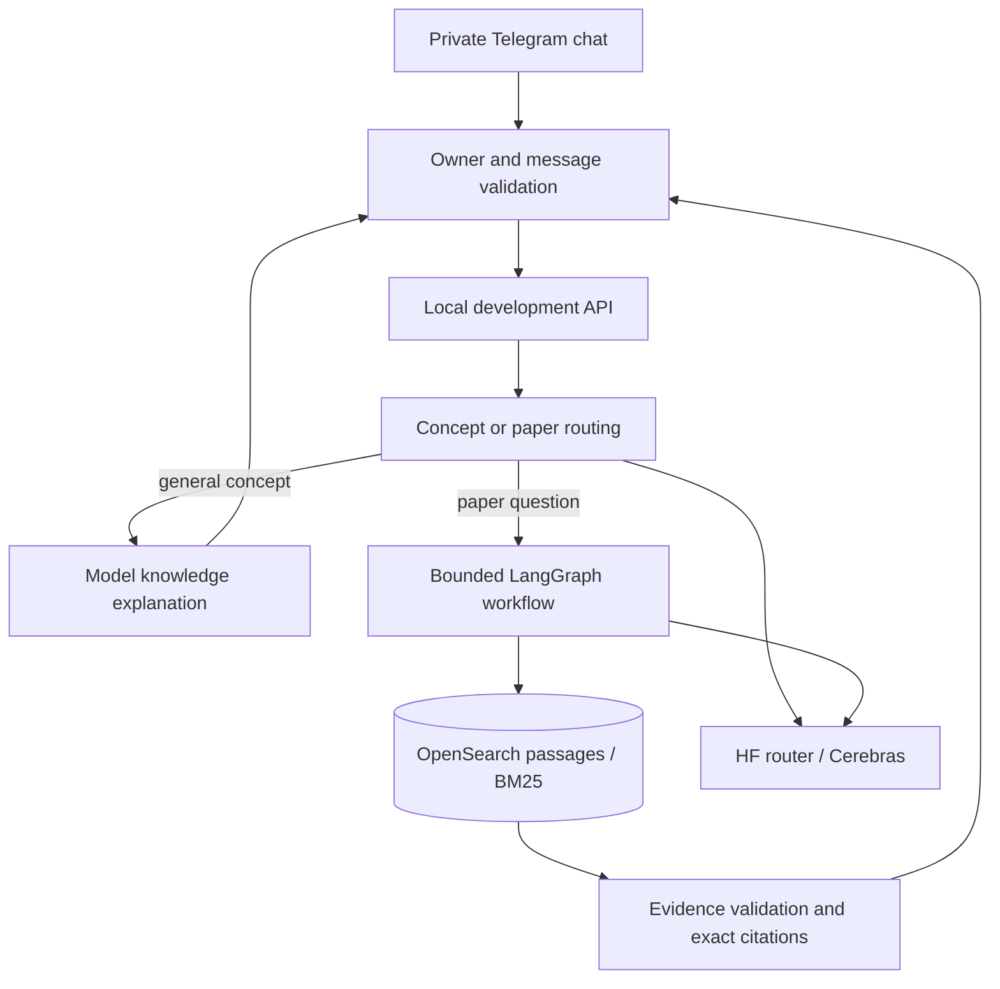

# AI-ScholarLens

**Read AI papers. Trace the evidence. Build understanding.**

[بالمصري](README.ar.md) · [Visual codebase guide](codebase-overview.html) · [How we built it](docs/build-story.md) · [Contributing](CONTRIBUTING.md) · [MIT license](LICENSE)

ScholarLens is an experimental AI research assistant with a private Telegram interface. It explains general AI/ML concepts and answers questions about an indexed paper collection using cited evidence. The current prototype uses **LangGraph**, **OpenSearch**, and **Hugging Face Inference Providers**, with `openai/gpt-oss-120b:cerebras` for remote generation.

The next product direction is an **interactive paper tutor in Egyptian Arabic**: bring a paper by URL, title, or identifier; receive an initial guided lesson; then explore its methods, figures, equations, results, and limitations through conversation. That experience is being designed. It is not yet implemented.

> **Development prototype.** Private manual testing works. Formal paper-answer quality gates have not passed; valid questions can still produce insufficient evidence, and multi-paper coverage is limited. This is not a public hosted bot or a production release. See the [measured holdout result](docs/hf-cerebras-paced-holdout-result.md).

## What works today

| Capability | Current behavior |
| --- | --- |
| General AI/ML questions | Simple explanations, explicitly labeled as model knowledge |
| Paper questions | Retrieval, bounded LangGraph decisions, exact quotations and source citations |
| Private Telegram | Paired owner only; polling on the owner's PC |
| Hosted generation | HF routes requests to Cerebras; no local generation weights needed for this mode |
| Low-memory development | One API/bot process; BM25 search avoids local query embeddings |
| Existing platform | arXiv ingestion, Docling parsing, PostgreSQL, keyword/hybrid search, JSON/SSE answers and Gradio |
| Operational controls | API authentication, quotas, bounded calls, deadlines and durable Telegram offsets |

The development bot does **not** yet ingest a paper pasted into chat, remember an active paper across questions, generate teaching diagrams, run quizzes, or respond consistently in Egyptian Arabic. Those are [proposed capabilities](CAPABILITY_MAP.md). Scheduled paper discovery remains part of the existing platform; it is no longer the focus of the next product iteration.

## Try the current prototype

Examples for the existing collection:

- `What is RAG?` — general explanation, labeled as model knowledge.
- `Which dataset is used in When Does a Classifier Help an LLM?` — cited paper evidence.
- `What tool-use failures does SpeechGym identify?` — cited paper evidence.

Use the paper title and one specific question per message. Paper responses quote evidence; they do not yet provide a complete personalized lesson. The Telegram integration is private: contributors need their own bot and configuration.

## Run locally

### Prerequisites

- Python **3.12**, [uv](https://docs.astral.sh/uv/), and Docker Desktop/Compose.
- A local OpenSearch instance with indexed paper passages for paper questions.
- For private Telegram testing: your own bot token, verified owner account, HF inference token, and API key in private local configuration.

Create the Windows environment expected by `Telegram.ps1`:

```powershell
git clone https://github.com/Xmen3em/AI-ScholarLens.git
cd AI-ScholarLens
$env:UV_PROJECT_ENVIRONMENT = ".venv-win"
uv sync --frozen
Copy-Item .env.example .env
```

Review `.env` locally. Follow the [bot pairing guide](docs/telegram-langgraph.md#local-setup) and the [development runtime guide](docs/telegram-development.md). A fresh clone does not include credentials, paired state, model/tokenizer caches, or the development corpus. The [platform reference](docs/archive/platform-readme-20261016.md) and [testing guide](TESTING.md) describe ingestion and indexing prerequisites.

Check the configured development runtime without network calls or state writes:

```powershell
.venv-win/Scripts/python.exe -m src.commands.run_dev_bot --check
```

For a configured, paired installation with indexed passages:

```powershell
.\Telegram.ps1           # start private manual testing
.\Telegram.ps1 -Restart  # load source edits
.\Telegram.ps1 -Stop     # stop API and bot gracefully
```

This mode serves the agent API at `127.0.0.1:8002`, uses remote HF generation, and reports `accepted:false`. It requires 1,024 MiB free host RAM at startup and retains a 600 MiB live floor. It does not initialize SQL or load a local embedding model. These are free-RAM admission checks, not a total system RAM recommendation; Docker and the other services also consume memory.

For the broader Docker platform, start with `docker compose up --build -d` and follow [TESTING.md](TESTING.md). That is a separate mode with PostgreSQL, Airflow, and Ollama dependencies; it does not activate this private bot.

## How it works



The paper graph validates scope, retrieves passages, grades evidence, optionally rewrites once, then answers or abstains. Server-side validation owns the quoted text and citations. A concept explanation is labeled separately; missing paper evidence never silently becomes a model-knowledge answer.

| Start here | Responsibility |
| --- | --- |
| [development_assistant.py](src/services/development_assistant.py) | Concept explanations and routing to the paper graph |
| [agent.py](src/services/agent.py) | LangGraph paper workflow |
| [development_pc_api.py](src/services/development_pc_api.py) | Isolated hosted-generation runtime and admission limits |
| [telegram_bot.py](src/services/telegram_bot.py) | Private chat, command handling and reply formatting |
| [hf/](src/services/hf/) | HF transport, validation and token admission |
| [search.py](src/services/search.py) | Retrieval orchestration |
| [metadata_fetcher.py](src/services/metadata_fetcher.py) | Existing batch ingestion |
| [pdf_parser/](src/services/pdf_parser/) | Existing Docling parser |
| [evaluation/](evaluation/) | Versioned questions, reports and quality limitations |

## Checks and contributions

```powershell
.venv-win/Scripts/python.exe -m pytest tests/unit/test_development_assistant.py tests/unit/test_development_bot.py -q
.venv-win/Scripts/python.exe -m ruff check src tests
```

[TESTING.md](TESTING.md) covers the full suite and service-dependent checks. Live model calls and paid evaluations are separate from deterministic tests. Read [CONTRIBUTING.md](CONTRIBUTING.md) before changing evidence handling or adding a tool. Small fixes, Arabic terminology review, extraction fixtures, and reproducible quality reports are welcome.

## Where the project is going

1. Resolve the paper a researcher supplies and keep its version explicit.
2. Extract structured content; use OCR when needed, with an HF model chosen later.
3. Produce a first lesson in Egyptian Arabic, grounded in that paper.
4. Continue through guided questions, examples, comprehension checks and progress.
5. Add diagrams and inspectable charts, followed by a richer study view.
6. Add bounded research tools and optional private Notion study exports.

This is a proposed direction. Read the [capability map](CAPABILITY_MAP.md) and [technical research](docs/paper-learning-research.md) for dependencies, open decisions and the distinction between current behavior and future work.

## License and acknowledgements

Project code is available under the [MIT license](LICENSE). Papers, datasets, models, dependencies, and third-party assets retain their own licenses and terms. ScholarLens builds on FastAPI, LangGraph, OpenSearch, PostgreSQL, Docling, Ollama, Airflow and Hugging Face. The implementation grew from a Zero-to-RAG learning project; the [build story](docs/build-story.md) explains the work and its limits.
