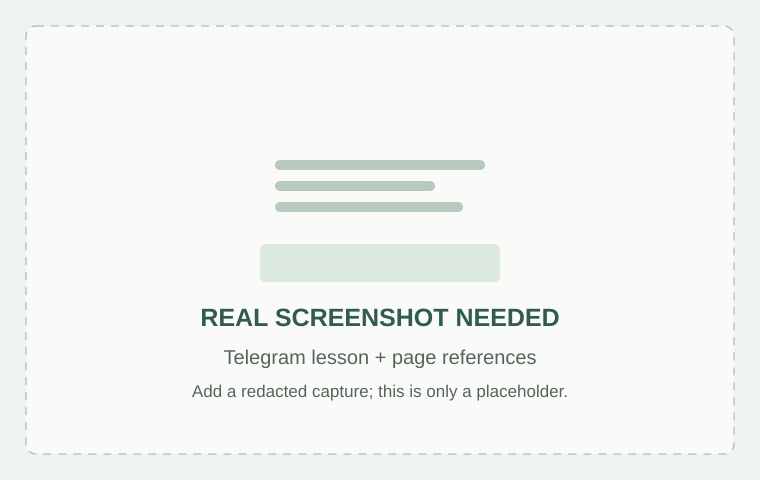
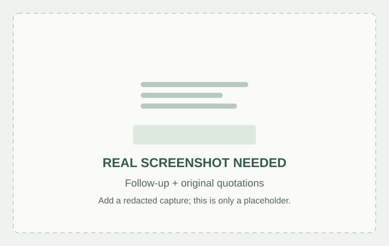
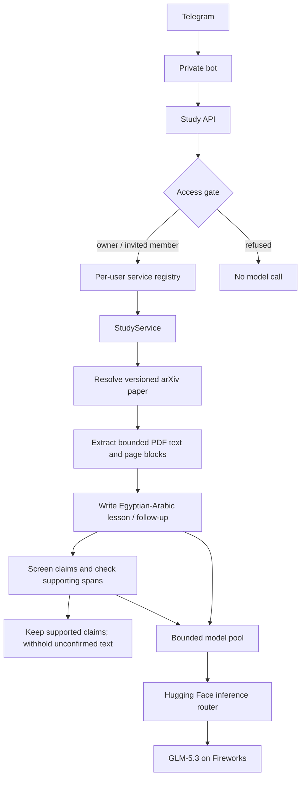

<div align="center">

# ScholarLens

**An Egyptian-Arabic Telegram tutor for arXiv AI papers, with paper claims linked to inspectable source excerpts and page references.**

[](https://github.com/Xmen3em/AI-ScholarLens/actions/workflows/ci.yml)
[](LICENSE)
[](pyproject.toml)

[Explore the system](https://scholarlens.pages.dev) · [Quick start](#quick-start) · [Benchmark](#benchmark-results) · [Paper-study guide](docs/paper-study-guide.md) · [بالمصري](README.ar.md)

</div>

> [!IMPORTANT]
> ScholarLens is an open-source development prototype for private or invited use, not a hosted public service. Scientific explanations still need human review. The measured holdout failed its p95 latency gate, and holdout faithfulness was never measured. [Read the results and limitations](#benchmark-results).

## Why ScholarLens?

Reading an AI paper means tracking definitions, methods, experiments and caveats across pages. ScholarLens turns one selected arXiv version into an Egyptian-Arabic lesson you can question, while retaining the original English excerpts for inspection. It separates paper-grounded statements from background knowledge and teaching analogies, and withholds claims that fail its checks rather than presenting them as verified paper findings.

## Features

- **Claim-level grounding with page badges.** The writer cites server-issued evidence IDs; the application copies exact excerpts, checks numeric literals, and asks a checker for supporting spans. Unconfirmed paper claims are withheld. Telegram displays the pages for surviving claims. Exact spans do not prove correct scientific interpretation.
- **Follow-up dialogue.** Ask about the selected paper, request a simpler explanation or example, choose beginner/researcher depth, or start a conversational comprehension question. Up to four recent turns are carried as dialogue, never as source evidence.
- **Study notes and reading maps.** `/notes` returns the saved first lesson and its original quotations. A generated reading map orders reviewed lesson sections and references source blocks; it does not infer scientific diagrams or causal relationships.
- **`/deep` research mode.** An optional, owner-only Deep Agents worker reads the current paper with bounded tools and a shared call budget. It requires a separate research environment and still has an unresolved live failure; offline tests do not qualify it as repaired.
- **Invite-only multi-user beta.** `STUDY_MULTI_USER=true` enables one-time invitations, per-student Cairo-day limits, a shared dollar ceiling, rate limits, fair model-call slots, and retention controls. `/deep` remains owner-only. This mode is implemented and tested offline; its live Telegram acceptance is pending.
- **Pinned GLM tokenizer admission.** An explicitly downloaded, SHA-256-verified GLM-5.3 tokenizer counts the serialized request before admission. Requests over 20,000 estimated input tokens are refused; a conservative UTF-8-bytes estimate is used if the tokenizer is unavailable.
- **30-paper benchmark.** Twelve development and eighteen holdout papers across six fields exercise lessons and three follow-ups. The published holdout result is incomplete: delivery and latency were measured, but its single judging attempt stopped on HTTP 429 with **0/47 answers scored**.

## Demo

Real Telegram screenshots will be added here. The repository deliberately contains no fabricated screenshots or GIFs.

| Paper lesson and page references | Follow-up and original quotations |
| --- | --- |
|  |  |

To replace them, add real, redacted Telegram captures under `docs/assets/` and update these image paths. Do not include private messages, account identifiers, invite codes, credentials, or the private benchmark paper's text/questions.

## Quick start

### Windows

Prerequisites: Python **3.12**, [uv](https://docs.astral.sh/uv/), a Telegram bot token from BotFather, and a Hugging Face token permitted to use the configured inference provider. Costs depend on your provider and usage.

The study workflow itself uses public arXiv PDFs and local SQLite, not OpenSearch or local generation weights. The launcher validates the older collection-answer path's local configuration too: it expects loopback OpenSearch `http://localhost:9200`, Ollama `http://localhost:11434`, and PostgreSQL on localhost port 5432. Those services are needed for the older collection-answer mode, not for native arXiv study. See [legacy runtime notes](docs/prototype-notes.md#run-locally).

```powershell
git clone https://github.com/Xmen3em/AI-ScholarLens.git
Set-Location AI-ScholarLens
$env:UV_PROJECT_ENVIRONMENT = ".venv-win"
uv sync --frozen --inexact
Copy-Item .env.example .env
```

Create a random `API_KEY` of at least 32 characters. Put it, `HF_TOKEN`, and `TELEGRAM_BOT_TOKEN` in `.env`; leave `TELEGRAM_ENABLED=false` during pairing. Never commit `.env`. The selected-paper tutor's route is fixed to `zai-org/GLM-5.3:fireworks-ai`; changing the older `HF_MODELS` setting does not select a different tutor model.

```powershell
.venv-win/Scripts/python.exe -m src.commands.prepare_hf_tokenizer --download
.venv-win/Scripts/python.exe -m src.commands.prepare_glm_tokenizer --download
```

These commands download public tokenizer data, verify its hash, and store it under ignored `data/pc-app/tokenizer/`: the GLM-5.3 tokenizer at a pinned Hugging Face revision and the legacy assistant's `o200k_base` vocabulary. The launcher verifies both, even if you only use native arXiv study. They do not download model weights or make inference calls. Run either command without `--download` to check an already prepared file.

Check the local runtime first; this performs no network or state writes:

```powershell
.venv-win/Scripts/python.exe -m src.commands.run_dev_bot --check
```

For a new bot, pair the owner explicitly. Replace `YOUR_BOT_USERNAME` with your bot's username, without `@`:

```powershell
.venv-win/Scripts/python.exe -m src.commands.setup_telegram --prepare --username YOUR_BOT_USERNAME
# Open the printed private pairing link and press Start, then:
.venv-win/Scripts/python.exe -m src.commands.setup_telegram --verify
```

`--prepare` performs read-only Telegram identity/webhook calls and creates a private one-hour pairing link. `--verify` reads pending updates once and saves the proven owner ID. Neither starts the bot or sends a Telegram message. Do not pair while the bot is enabled. [Pairing details and recovery](docs/telegram-langgraph.md#local-setup).

Start the private runtime only when you are ready to use the configured remote models:

```powershell
.\Telegram.ps1
# After source edits:
.\Telegram.ps1 -Restart
# Stop the bot and API:
.\Telegram.ps1 -Stop
```

The launcher serves the local API at `127.0.0.1:8002`, polls Telegram, and allows user-triggered remote model calls. Startup requires at least 1,024 MiB free host RAM; each model call retains a 600 MiB free-RAM floor. These are free-memory checks, not total-machine RAM recommendations.

Try:

```text
/paper https://arxiv.org/abs/2005.11401v4
اشرح الفرق بين retriever و generator بمثال بسيط
/notes
```

For title search, use `/paper Attention Is All You Need`, then `/choose 1`. Other commands are in the [paper-study guide](docs/paper-study-guide.md).

### Linux

The Python modules run with Python 3.12, but `Telegram.ps1` is a PowerShell launcher and the optional research interpreter lookup is Windows-specific. `run_dev_bot` is the source-verified module that starts the same local API and bot; the commands below have not been run as a complete Linux quick start. Run them only when you intend to prepare remote-provider access and permit user-triggered model calls:

```bash
uv sync --frozen --python 3.12
cp .env.example .env
# Set API_KEY, HF_TOKEN, TELEGRAM_BOT_TOKEN and TELEGRAM_OWNER_ID in .env.
uv run --frozen python -m src.commands.prepare_hf_tokenizer --download
uv run --frozen python -m src.commands.prepare_glm_tokenizer --download
uv run --frozen python -m src.commands.run_dev_bot --check
uv run --frozen python -m src.commands.run_dev_bot --execute
```

CI runs the tests on Ubuntu. The complete interactive bot experience has not been qualified on Linux; reading-map generation requires suitable Arabic shaping/font support and may omit the map when unavailable.

## Configuration

Copy [`.env.example`](.env.example) to `.env`. These are the main private-runtime settings; the template also documents the broader platform's optional services.

| Variable | Default in template | Purpose |
| --- | --- | --- |
| `API_KEY` | blank; required by the development runtime | API authentication key, sent by the local bot as `X-API-Key`; minimum 32 characters |
| `API_REQUESTS_PER_MINUTE` | `60` | API request quota |
| `API_GENERATIONS_PER_MINUTE` | `6` | API generation quota; study message requests consume this quota even without a model call |
| `HF_TOKEN` | blank; required for generation | Server-side Hugging Face token; never expose it in a browser |
| `HF_MODELS` | `openai/gpt-oss-120b:groq` | Legacy assistant profiles; the development runtime overrides this to its registered Cerebras profile |
| `HF_DEFAULT_MODEL` | `openai/gpt-oss-120b:groq` | Legacy default, not the selected-paper tutor's GLM/Fireworks route |
| `HF_TIMEOUT_SECONDS` | `30` | Legacy hosted-client timeout; the study transport has its own bounds |
| `TELEGRAM_ENABLED` | `false` | Keep disabled for owner pairing; the development launcher enables the bot explicitly |
| `TELEGRAM_BOT_TOKEN` | blank | Your private BotFather token |
| `TELEGRAM_OWNER_ID` | blank until pairing | Numeric Telegram account ID of the owner; `setup_telegram --verify` can establish it |
| `TELEGRAM_API_BASE_URL` | `http://127.0.0.1:8000/api/v1` | Bot's API base; the development launcher overrides it to port 8002 |
| `TELEGRAM_OFFSET_PATH` | `./data/telegram/offset.json` | Durable Telegram offset under ignored local data |
| `STUDY_MULTI_USER` | `false` | `true` enables the invite-only beta; otherwise only the owner is accepted |
| `STUDY_DAILY_PAPERS` | `3` | Delivered first-lesson allowance per student per Cairo day; owner exempt from counts |
| `STUDY_DAILY_QUESTIONS` | `30` | Delivered follow-up allowance per student per Cairo day; owner exempt from counts |
| `STUDY_DAILY_USD_CEILING` | `2.00` | Shared daily accounting ceiling, including owner study calls |
| `STUDY_PARALLEL_JOBS` | `3` | Shared model-call slots, validated to 1–4; review halves share their job's slot |
| `STUDY_MESSAGES_PER_MINUTE` | `6` | Per-user message-rate window |
| `STUDY_RETENTION_DAYS` | `30` | Delete inactive student study content after this period; accounting remains |
| `OPENSEARCH_HOST` | `http://localhost:9200` | Older indexed-collection retrieval, not native arXiv study |
| `POSTGRES_DATABASE_URL` | local PostgreSQL URL in template | Older platform configuration, not study-session storage |

**Dollar ceiling:** before a job starts, the beta reserves its worst case: three calls for a lesson/follow-up and four for `/deep`. Settled usage replaces reservations. Missing usage and uncertain calls are conservatively charged at the worst case. This is application accounting at configured profile prices and provider-reported costs, not a provider billing guarantee or an invoice.

**Invites:** `/invite` or `/invite N` is owner-only (1–10 codes). A student redeems `/start CODE`. `/usage`, `/privacy`, `/members`, `/revoke USER_ID` and `/forget` are described in the [multi-user specification](docs/specs/multi-user.md).

## How it works



The API passes a member to their own `StudyService`; its LangGraph nodes are `resolve → extract → teach`. Validation, claim checks, persistence and rendering happen inside the teaching path. `/deep` uses a separate bounded worker before the same parent validation/checking path. The older concept/collection assistant is a separate route and is not evidence for this study flow.

**Key bounds:** 20 MiB and 45 pages per PDF; up to 300 extracted evidence blocks; up to four model attempts per study intent; 128,000 serialized request bytes and 20,000 estimated input tokens; at most 3,000 output tokens per call. Native PDF extraction is implemented. The OCR adapter is opt-in and not enabled in the bot; scanned or unsupported pages are not treated as fully read.

## Benchmark results

The [full report](evaluation/paper_benchmark/REPORT.md) measures the frozen **GLM-5.3 / DeepInfra** configuration. It is not a result for the current Fireworks route. Production moved from DeepInfra to Fireworks on 25 November 2026 after DeepInfra stopped serving GLM-5.3. One Fireworks development qualification lesson is not a new benchmark.

| Frozen holdout metric | Result | Interpretation |
| --- | ---: | --- |
| Delivered first lessons + Q1/Q2 | 47/54 (87.0%) | Seven planned answers undelivered |
| Writer format compliance | 67/68 calls (98.53%) | Pass: gate ≥95% |
| Median job latency | 25.766 s | Descriptive |
| Nearest-rank p95 job latency | **94.485 s** | **Fail: gate ≤90 s** |
| Holdout generation accounting | $1.36776250 | Estimated from recorded usage/worst cases, not an invoice |
| Judge agreement / Cohen's κ | 34/40 = 85% / 0.6712 | Calibration gates pass; labels were owner-delegated AI judgments |
| Holdout faithfulness / factual correctness | **Unmeasured** | Judging stopped on HTTP 429; **0/47 scored** |
| Owner-delegated six-lesson rubric | 3.5833/5 | Small AI-delegated rating, not an independent human evaluation |

**Caveats.** Labels and ratings were supplied by the assistant under explicit owner delegation, not independently by humans. Calibration compared a judge with those AI-delegated labels; it was **not calibration against human labels** and does not supply missing holdout scores. This is a small assistant-authored benchmark without statistical-significance or four-model holdout comparison claims. GLM was selected from development results. Thirteen Q3 answers require human reading. See the [protocol](evaluation/paper_benchmark/PROTOCOL.md) and [report](evaluation/paper_benchmark/REPORT.md) for denominators, failures, withheld reasons and reproducibility limits.

## Project structure

```text
src/
├── commands/               # Explicit local setup, runtime and evaluation commands
├── services/
│   ├── study/              # Intake, PDF content, LangGraph tutor, evidence, access and storage
│   ├── hf/                 # HF transport and legacy model/tokenizer support
│   ├── development_pc_api.py
│   └── telegram_bot.py
├── config.py
└── routers/                # Broader platform API
site/                       # Dependency-free explainer site for Cloudflare Pages
docs/
├── specs/                  # Current design decisions, status and trade-offs
├── assets/                 # Screenshot placeholders; replace with real captures
└── prototype-notes.md      # Preserved previous README and historical notes
evaluation/paper_benchmark/ # Frozen public benchmark artifacts and report
research/                   # Isolated optional /deep dependencies and tests
tests/unit/                 # Mocked unit tests
tests/api/                  # API tests
Telegram.ps1                # Windows private-runtime launcher
.github/workflows/ci.yml    # Ruff, mypy and unit/API tests on Ubuntu
```

## Testing

All regular unit/API providers are mocked. Tests needing unavailable local tokenizer files or snapshots skip with a reason.

```powershell
.venv-win/Scripts/python.exe -m pytest tests/unit tests/api -q -p no:cacheprovider --basetemp tests/test_output/main
.venv-win/Scripts/python.exe -m ruff check src tests
.venv-win/Scripts/python.exe -m mypy src
```

[CI](.github/workflows/ci.yml) runs the equivalent checks with uv on Python 3.12/Ubuntu. [TESTING.md](TESTING.md) covers the broader platform and service-dependent checks. Paid inference, paper downloads, live Telegram operations and benchmark judging are not part of the ordinary suite; run them only through an explicitly reviewed scope.

## Website and free static deployment

The [ScholarLens site](https://scholarlens.pages.dev) explains the product flow, claim checking, multi-user controls, model routing and benchmark without requiring JavaScript. Its source is [`site/`](site/): plain HTML, CSS, small optional JavaScript enhancements, and inline SVG. No build step, tracking, framework or runtime dependency.

Open [`site/index.html`](site/index.html) directly in a browser. To deploy the static source to Cloudflare Pages yourself:

```bash
npx wrangler@3 login
npx wrangler@3 pages deploy site --project-name scholarlens
```

Or use **Cloudflare dashboard → Workers & Pages → Create → Pages → Connect to Git**, select `Xmen3em/AI-ScholarLens`, leave the build command empty, and set the build output directory to `site`. The default `scholarlens.pages.dev` address is available only after you create/deploy that project; [site/README.md](site/README.md) documents local review and content sources.

## Roadmap

- Complete an explicitly approved, retry-guarded holdout judging run and human review of teaching quality.
- Reduce first-lesson latency and re-measure the current Fireworks route; do not transfer the frozen DeepInfra numbers to it.
- Reproduce and qualify `/deep` on the exact live research question; keep offline-only claims separate.
- Improve verified table/equation semantics and independently evaluate bilingual supporting-region retrieval.
- Qualify OCR on scientific scans and inspect visual provenance before enabling it.
- Complete the invite-only beta's live acceptance and decide richer study views/progress design.
- Add real redacted Telegram screenshots to this README.

## Contributing

See [CONTRIBUTING.md](CONTRIBUTING.md). Useful contributions include redacted missed-evidence cases, Egyptian scientific-language review, extraction fixtures, and reproducible offline tests. Preserve source identity, explicit uncertainty and per-user boundaries. Never commit private conversations, credentials, local `data/`, or private benchmark content.

## License and acknowledgements

Project code is available under the [MIT license](LICENSE). Papers, datasets, models, dependencies and third-party assets retain their own licenses and terms. ScholarLens builds on FastAPI, LangGraph, OpenSearch, PostgreSQL, Docling, Ollama, Airflow, Deep Agents, Pillow and Hugging Face. The implementation grew from a Zero-to-RAG learning project; the [build story](docs/build-story.md) explains its development and limitations.
