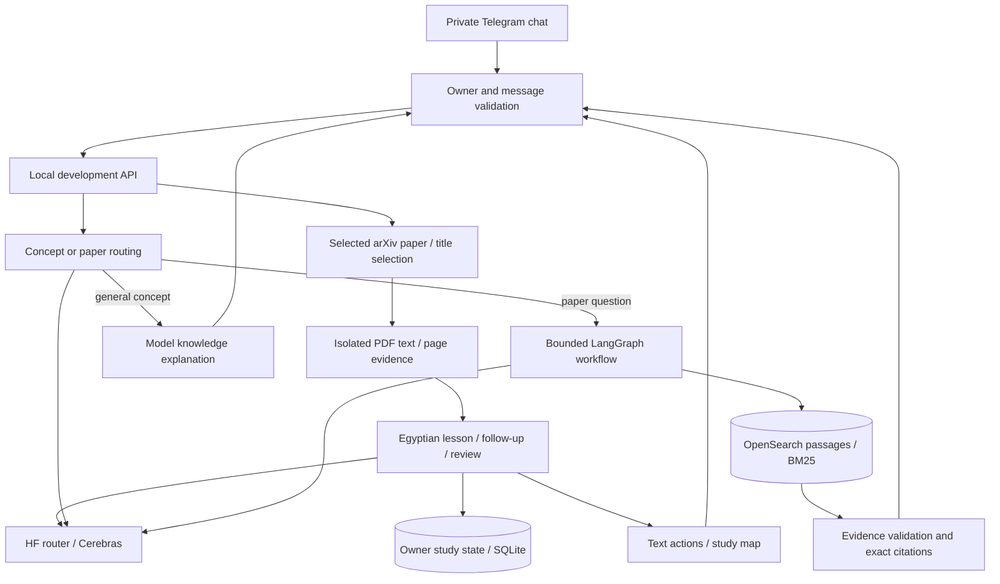

# AI-ScholarLens

**Read AI papers. Trace the evidence. Build understanding.**

[بالمصري](README.ar.md) · [Paper-study guide](docs/paper-study-guide.md) · [Visual baseline guide](codebase-overview.html) · [How we built it](docs/build-story.md) · [MIT license](LICENSE)

ScholarLens is an experimental paper-learning assistant with a private Telegram interface. Bring an AI paper from arXiv, receive an initial lesson in Egyptian Arabic, and explore that paper through follow-up questions, examples and comprehension checks. It uses **LangGraph** and **Hugging Face Inference Providers**, with `openai/gpt-oss-120b:cerebras` for remote generation.

The selected-paper workflow is implemented on `codex/paper-intake` and has passed bounded live development checks for a lesson, Arabic follow-up and restricted **Deep Agents** tool use. It retains general concept explanations and cited answers over the existing OpenSearch collection. See the [implementation report](docs/paper-study-implementation.md) for measured results and limitations.

> **Development prototype.** Scientific explanations and Egyptian wording still need human review and an independent learning-quality evaluation. The earlier indexed-paper quality gates have not passed; see the [holdout result](docs/hf-cerebras-paced-holdout-result.md). This is a private PC prototype, not a public hosted service.

## What works today

| Capability | Current behavior |
| --- | --- |
| Bring a paper | arXiv URL/ID with explicit version; title matches require selection |
| Egyptian Arabic lessons | Initial teaching, paper-scoped follow-ups and labeled examples |
| Evidence | Server-owned exact excerpts, ID/numeric validation and a bounded grounding review |
| Study interaction | Telegram keyboard, conversational comprehension questions, depth selection and study maps |
| Memory | Four recent turns per paper, expiry, explicit preferences and `/forget` |
| Optional research | Isolated Deep Agents with source read tools; optional read-only local MCP |
| General AI/ML questions | Simple explanations, explicitly labeled as model knowledge |
| Paper questions | Retrieval, bounded LangGraph decisions, exact quotations and source citations |
| Private Telegram | Paired owner only; polling on the owner's PC |
| Hosted generation | HF routes requests to Cerebras; no local generation weights needed for this mode |
| Low-memory development | One API/bot process; BM25 search avoids local query embeddings |
| Existing platform | arXiv ingestion, Docling parsing, PostgreSQL, keyword/hybrid search, JSON/SSE answers and Gradio |
| Operational controls | API authentication, quotas, bounded calls, deadlines and durable Telegram offsets |

OCR is an implemented but disabled candidate adapter; live image qualification, reliable figure/equation interpretation, scored learning progress, web study UI and application-level Notion export remain future work. Scheduled discovery belongs to the existing platform and is outside the learning flow.

## Try the current prototype

Start with one paper:

```text
/paper https://arxiv.org/abs/2005.11401v4
اشرح الفرق بين retriever و generator بمثال بسيط
اختبر فهمي
/notes
```

For title search use `/paper Attention Is All You Need`, then `/choose 1`. Use `/study` for the current version, `/level researcher` for more depth, and `/forget` to clear study context. The [study guide](docs/paper-study-guide.md) explains optional `/deep`, coverage, retention and failure behavior.

Examples for the older collection/concept modes:

- `What is RAG?` — general explanation, labeled as model knowledge.
- `Which dataset is used in When Does a Classifier Help an LLM?` — cited paper evidence.
- `What tool-use failures does SpeechGym identify?` — cited paper evidence.

When a paper is active, ordinary messages refer to that paper. The Telegram integration is private: contributors need their own bot and configuration.

## Run locally

### Prerequisites

- Python **3.12** and [uv](https://docs.astral.sh/uv/). Docker Desktop/Compose is needed for the broader platform services, not native arXiv study itself.
- A local OpenSearch instance with indexed passages for the older collection-answer mode. New arXiv study uses its own source cache and SQLite.
- For private Telegram testing: your own bot token, verified owner account, HF inference token, and API key in private local configuration.

Create the Windows environment expected by `Telegram.ps1`:

```powershell
git clone https://github.com/Xmen3em/AI-ScholarLens.git
cd AI-ScholarLens
$env:UV_PROJECT_ENVIRONMENT = ".venv-win"
uv sync --frozen --inexact
Copy-Item .env.example .env
```

Review `.env` locally. Follow the [bot pairing guide](docs/telegram-langgraph.md#local-setup) and the [development runtime guide](docs/telegram-development.md). A fresh clone does not include credentials, paired state, model/tokenizer caches, or the development corpus. The [platform reference](docs/archive/platform-readme-20261016.md) and [testing guide](TESTING.md) describe ingestion and indexing prerequisites.

Check the configured development runtime without network calls or state writes:

```powershell
.venv-win/Scripts/python.exe -m src.commands.run_dev_bot --check
```

For a configured, paired installation with indexed passages:

```powershell
.\Telegram.ps1           # start private manual testing
.\Telegram.ps1 -Restart  # load source edits
.\Telegram.ps1 -Stop     # stop API and bot gracefully
```

This mode serves the agent API at `127.0.0.1:8002`, uses remote HF generation, and reports `accepted:false`. It requires 1,024 MiB free host RAM at startup and retains a 600 MiB live floor. It does not initialize SQL or load a local embedding model. These are free-RAM admission checks, not a total system RAM recommendation; Docker and the other services also consume memory.

For the broader Docker platform, start with `docker compose up --build -d` and follow [TESTING.md](TESTING.md). That is a separate mode with PostgreSQL, Airflow, and Ollama dependencies; it does not activate this private bot.

## How it works



The study graph resolves, extracts and teaches one selected version. Source validation and review precede delivery; follow-ups use that paper's bounded context. The older collection graph validates scope, retrieves passages, grades evidence, optionally rewrites once, then answers or abstains. Concept explanations are labeled as model knowledge.

| Start here | Responsibility |
| --- | --- |
| [study/](src/services/study/) | Paper intake, extraction, learning state, tutor, tools and visuals |
| [development_assistant.py](src/services/development_assistant.py) | Concept explanations and routing to the paper graph |
| [agent.py](src/services/agent.py) | LangGraph paper workflow |
| [development_pc_api.py](src/services/development_pc_api.py) | Isolated hosted-generation runtime and admission limits |
| [telegram_bot.py](src/services/telegram_bot.py) | Private chat, command handling and reply formatting |
| [hf/](src/services/hf/) | HF transport, validation and token admission |
| [search.py](src/services/search.py) | Retrieval orchestration |
| [metadata_fetcher.py](src/services/metadata_fetcher.py) | Existing batch ingestion |
| [pdf_parser/](src/services/pdf_parser/) | Existing Docling parser |
| [evaluation/](evaluation/) | Versioned questions, reports and quality limitations |

## Checks and contributions

```powershell
.venv-win/Scripts/python.exe -m pytest tests/unit/test_development_assistant.py tests/unit/test_development_bot.py -q
.venv-win/Scripts/python.exe -m ruff check src tests
```

[TESTING.md](TESTING.md) covers the full suite and service-dependent checks. Live model calls and paid evaluations are separate from deterministic tests. Read [CONTRIBUTING.md](CONTRIBUTING.md) before changing evidence handling or adding a tool. Small fixes, Arabic terminology review, extraction fixtures, and reproducible quality reports are welcome.

## Next extensions

1. Qualify hosted OCR on scientific scans and difficult tables.
2. Evaluate Egyptian scientific teaching and missing-evidence behavior independently.
3. Explain source figures and equations with inspected visual provenance.
4. Add a richer web study view and explicit learning-progress design.
5. Add reviewed external research and optional private Notion export.

Read the [implementation report](docs/paper-study-implementation.md), [current engineering research](docs/research/paper-learning-20261017/DECISIONS.md), and [deferred review questions](docs/paper-study-review.ar.md). The visual HTML guide describes the earlier platform baseline; the study guide covers this iteration.

## License and acknowledgements

Project code is available under the [MIT license](LICENSE). Papers, datasets, models, dependencies, and third-party assets retain their own licenses and terms. ScholarLens builds on FastAPI, LangGraph, OpenSearch, PostgreSQL, Docling, Ollama, Airflow and Hugging Face. The implementation grew from a Zero-to-RAG learning project; the [build story](docs/build-story.md) explains the work and its limits.
