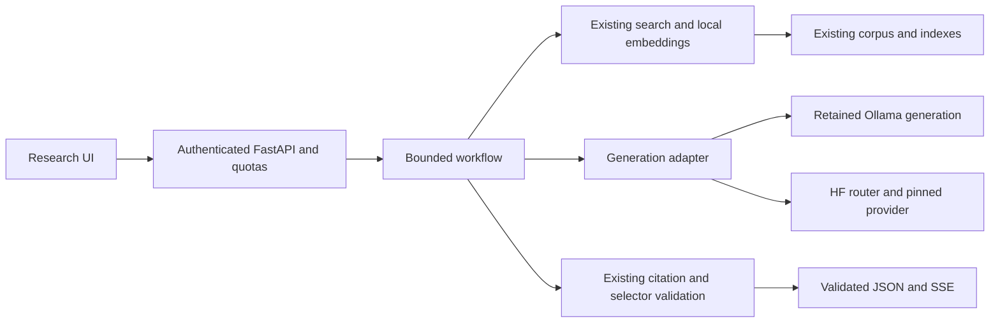

# Hugging Face hosted generation: research and implementation plan

Implementation update: the user approved HF-1 through HF-4 and the disabled
[adapter checkpoint](hf-inference-adapter.md) now passes 698 tests. Initial
registry: Groq/Fireworks GPT-OSS; Qwen/richer profiles await qualification.
Conservative schema-inclusive byte admission rejects the original 30-ID schema
before inference; guards remain intact. Specify this profile limit in HF-5 before
paid evaluation. Research-only statements below describe the preceding planning
turn, not the current source checkpoint.

Prepared 2026-10-13, Africa/Cairo. **Research and planning only:** no hosted
generation, account/billing change, dependency installation, application change,
deployment or model download was performed. Existing Week 7 implementation and
its 607-test result remain the last implementation checkpoint.

## Recommendation

Use **Hugging Face Inference Providers with HF-routed billing** for generation.
This moves language-model inference off this laptop while retaining PostgreSQL,
OpenSearch, the corpus, local query embeddings and all citation/selector guards.
The current local pilot cannot start at 1,354.54 MiB host headroom against its
frozen 3,072 MiB admission criterion. Hosted generation addresses the large local
generation-model allocation; retrieval, embeddings and other services still need
measured local capacity. The existing local pilot remains honestly `not_started`.

My engineering recommendation is to qualify **`openai/gpt-oss-120b:groq` first**
for today's short, bounded controller/selection calls, with
**`Qwen/Qwen3.8-27B:deepinfra`** as a development challenger. Use one selected pair
throughout the first hosted workflow. For future complex research and planning,
**`moonshotai/Kimi-K3:deepinfra`** is my first quality-oriented candidate, with
**`zai-org/GLM-5.3:fireworks-ai`** as a challenger. Introduce that second tier only
when measured tasks justify it. These are recommendations for evaluation, not
claims that a universally best model or a production-ready default was measured.

The recommendation follows this project's needs: fast repeated small decisions
now, reliable evidence selection, and richer agent tools later. A flagship's
coding benchmark does not establish research-answer relevance in this corpus.
Model-author evaluations suggest candidates; project evaluations choose them.

A stronger model may improve the agent's relevance and rewrite decisions. It
cannot supply absent corpus evidence or bypass the retained lexical/excerpt
filters. Known false abstentions or multi-paper coverage defects may remain;
their policy tuning is separate work and remains outside this continuation.

HF's provider router offers shared authentication and usage-based billing.
Dedicated Inference Endpoints are a different infrastructure option. For a
low-traffic resume project, shared hosted inference is the first choice; a
dedicated GPU becomes useful if a specific revision, custom serving stack or
measured isolation/throughput requirement demands it. The similarly named
`hf-inference` provider focuses largely on CPU tasks and is not the general
flagship-model route. [HF provider overview](https://huggingface.co/docs/inference-providers/index),
[billing and HF Inference scope](https://huggingface.co/docs/inference-providers/pricing).

## Verified shortlist and limitations

Public metadata was retrieved directly from HF's router, without authentication
or inference. The [saved catalog snapshot](research/hf-inference-models-20261013.json)
contains six models, all their returned provider entries, Hub revisions/licenses,
retrieval time and the inspected LangChain source revision. Its SHA-256 is
`ac9726a02295313dbb44a355315cecb5b6c26b5f2ab0593792d4709d6d3b71b7`.

Every pair below was marked live and advertised both tool calling and structured
output at lookup time. That metadata does **not** prove our exact schemas work.
Prices are USD per million input/output tokens. Probe figures are HF's latest
provider validation signals, **not** measurements from this laptop or guarantees.

| Role | Explicit HF model/provider | Input / output price | Probe first token / output speed | Decision |
| --- | --- | --- | --- | --- |
| First bounded-workflow candidate | `openai/gpt-oss-120b:groq` | $0.15 / $0.75 | 648 ms / 389 tokens/s | Test original schemas and low reasoning effort before development collection |
| Compact controller challenger | `Qwen/Qwen3.8-27B:deepinfra` | $0.20 / $2.50 | 338 ms / 72 tokens/s | Model supports thinking off; provider/router parameter support must be qualified |
| Future complex research candidate | `moonshotai/Kimi-K3:deepinfra` | $2.85 / $14.25 | 544 ms / 27 tokens/s | Always thinks; needs preserved assistant reasoning/tool history and a new bounded policy |
| Future agent challenger | `zai-org/GLM-5.3:fireworks-ai` | Not returned | 507 ms / 60 tokens/s | Obtain current routed price and check reasoning/schema behavior before trials |
| Additional reasoning challenger | `deepseek-ai/DeepSeek-V4-Pro-0813:baseten` | $1.32 / $3.96 | 271 ms / 88 tokens/s | Reserve for later research tasks; qualify parameter support |
| Speed candidate with schema incompatibility | `openai/gpt-oss-120b:cerebras` | $0.35 / $0.75 | 272 ms / 1,032 tokens/s | Defer: strict schema does not support our selector's `pattern` |

These fields, their units and their optional nature are documented by
[HF's model/provider catalog API](https://huggingface.co/docs/inference-providers/hub-api).
Availability and prices must be rechecked immediately before paid trials. A Hub
model existing or trending does not establish hosted availability.

Important model-specific findings:

- Kimi K3 is an author-released multimodal agentic model aimed at long tasks and
  knowledge work. It always enables thinking, defaults to maximum reasoning
  effort, and requires complete assistant messages including `reasoning_content`
  and `tool_calls` to be preserved between tool rounds. This makes it a useful
  future candidate, with meaningful latency and adapter requirements.
  [Kimi K3 model card](https://huggingface.co/moonshotai/Kimi-K3).
- GLM 5.3's author reports coding and automation gains and configurable reasoning
  effort, defaulting to maximum. Those author results do not justify increasing
  our existing selector limits or claiming a research-quality improvement.
  [GLM 5.3 model card](https://huggingface.co/zai-org/GLM-5.3).
- Qwen 3.8 27B documents per-request thinking control. The flagship
  `Qwen/Qwen3.8-2.4T-A95B` is also hosted and retained in the snapshot, but its card
  distinguishes its open release from Qwen Cloud's enhanced Max service; do not
  transfer Max's features or benchmark scores to the HF route without checking.
  [27B model card](https://huggingface.co/Qwen/Qwen3.8-27B),
  [flagship model card](https://huggingface.co/Qwen/Qwen3.8-2.4T-A95B).

## Credits, price and service choice

Use an HF token with routed requests and **no custom provider key** for the chosen
providers if HF credits are meant to pay for inference. Custom provider keys
change billing to that provider and do not consume the included HF credits.
Current documentation lists $2/month of general compute credits for PRO and
$2/seat for Team/Enterprise; free accounts need purchased credits. Included paid
plan credits now cover other HF compute services too. Confirm the user's actual
credit type, billing account and custom-key settings before a paid run; no
account balance was inspected here. HF documents provider pricing without markup.
[HF pricing and billing](https://huggingface.co/docs/inference-providers/pricing).

For scale only, a workload totaling **10,000 input + 1,000 output tokens across
all stages** at the saved Groq rates is $0.00225; the saved Kimi K3 rates give
$0.04275. These are arithmetic examples, not measured request costs. Reasoning,
repeated evidence, failed attempts and retries can add usage. Record actual
returned token usage, keep missing fields unknown, and compare estimates with
billing. Willingness to pay improves the candidate range; it does not remove
deadlines, work limits or the need to select on quality and latency.

## LangChain and transport decision

LangChain is an orchestration/integration layer; it does not supply a superior
version of an HF model. `ChatHuggingFace` can wrap a hosted `HuggingFaceEndpoint`.
`HuggingFacePipeline` loads models locally and does not address this RAM problem.
The integration documentation contains differing feature tables, so package
behavior must be checked rather than inferred from a checkmark.
[LangChain HF integration](https://docs.langchain.com/oss/python/integrations/chat/huggingface).

The inspected official source at commit
`948f6cc58cd3a045a8e72bfcf24715ecb27ae2c3` converts assistant messages without
`reasoning_content`; its `with_structured_output(method="json_schema")` branch
constructs a `json_object` response format. This observation is specific to that
source revision, not every released version. Pin and test any eventual wrapper
for exact wire format and reasoning round-trip support.
[Inspected HF chat integration source](https://github.com/langchain-ai/langchain/blob/948f6cc58cd3a045a8e72bfcf24715ecb27ae2c3/libs/partners/huggingface/langchain_huggingface/chat_models/huggingface.py).

Using `ChatOpenAI` with HF's compatible URL is possible for standard fields, but
LangChain explicitly says that adapter does not preserve provider-specific
reasoning fields. It is not an adequate unverified Kimi K3 tool-history adapter.
[LangChain ChatOpenAI scope](https://docs.langchain.com/oss/python/integrations/chat/openai).

**First implementation: a small native async adapter using existing `httpx`.**
Send chat completions to `https://router.huggingface.co/v1/chat/completions` with
the HF token and an explicit model/provider suffix. HF documents this compatible
router and provider pinning. Retain raw provider messages privately only where
needed for validated future tool turns, with bounded ephemeral history; keep
reasoning out of API responses, SSE, traces, cache and saved evaluation text.
[HF chat contract](https://huggingface.co/docs/inference-providers/tasks/chat-completion),
[explicit routing](https://huggingface.co/docs/inference-providers/index).

LangGraph remains a later orchestration option for branching research tools and
bounded state. First qualify generation with the existing finite workflow; a
framework addition is not required to fix inference location. If later introduced,
wrap the qualified adapter and preserve cancellation, call accounting and every
server guard. Avoid installing the documentation's local GPU dependency bundle.

## Exact schemas and current workflow

Keep the canonical scope/relevance/rewrite schemas, selection regex, prompts and
server validation unchanged. Structured JSON guarantees structure only within a
provider's supported subset; it does not prove factual relevance.
[HF structured-output guidance](https://huggingface.co/docs/inference-providers/guides/structured-output),
[Groq structured-output contract](https://console.groq.com/docs/structured-outputs).

The current selector uses basic regex groups/alternatives/ranges, increasing known
IDs and at most three excerpts. Cerebras strict mode explicitly excludes string
`pattern` and array `maxItems`; it is therefore not an unchanged-schema candidate.
Do not strip constraints or silently fall back to JSON-object mode to make it
pass. A future explicit provider schema adaptation would need its own specification
and prove unchanged local validation before admission.
[Cerebras schema limitations](https://inference-docs.cerebras.ai/capabilities/structured-outputs).

Fireworks documents regex and length/array constraints, but unsupported regex
constructs can be ignored, and its reasoning/structured-output behavior needs
model-specific checks. Its documented schema behavior makes it a useful alternative
if the first pair rejects the original schemas. Provider metadata alone does not
qualify any pair. [Fireworks structured outputs](https://docs.fireworks.ai/structured-responses/structured-response-formatting).

If Groq rejects an original schema, qualify `openai/gpt-oss-120b:fireworks-ai`
next in development: the snapshot lists it live with tools/structured outputs,
$0.15/$0.60 input/output rates and a 107 tokens/s probe. This is an explicit
next experiment, not automatic request-time failover or a schema downgrade.

Retain the Week 7 ceilings: two retrievals, one rewrite, six generation attempts,
eight stages, 90-second overall/30-second stage deadlines, and existing size
bounds. Map controller `num_predict=256` and selector `num_predict=512` to explicit
provider completion bounds, without silently allocating unlimited reasoning tokens.
The existing temperature and selector policy stay fixed. If a model cannot return
the required content inside these limits, it fails this profile. Richer reasoning
requires a separate future policy, not quietly raised Week 7 limits.

No framework/client automatic retry is allowed to multiply work. Initially zero
transport retries; the existing bounded selector retry retains its current role.
No automatic provider/model failover or `:auto`/`:fastest` selection in evaluations.
Every remote attempt is counted. Abort local waiting on cancellation, while
recording that remote computation or billing may continue after disconnect.

## Architecture and preservation

Add a provider-neutral generation contract and registry rather than placing HF
IDs in fields named `ollama_models`. Preserve existing model names and behavior in
the default local profile. Hosted settings are additive, disabled by default,
and agent enablement remains a separate flag. Preserve the current API key and
JSON/SSE schemas; use the existing `model` field to report a registered effective
model identity. Arbitrary client-provided provider names or URLs are rejected.

Normalize content, finish state and real usage into a generation result; project
it to current callers where needed. Missing Ollama timing fields remain `None`.
Mechanically changing injection/type boundaries is permitted by this plan; it
does not authorize changing selection/rendering/lexical policy. Guard routines
and prompt bytes must be compared before/after those mechanical changes.

Keep **`nomic-embed-text` and its stored vectors unchanged**. Moving generation
does not require an embedding migration. A different embedding model would change
vector meaning even at the same dimension and would need a separate reindex plan.
BM25-only hosted trials can isolate generation before hybrid trials exercise local
query embeddings. No ingestion, model pull or index write belongs to this work.

Hosted trials remain uncached: the current signed answer-cache identity depends
on local model digests. Hosted model/provider identity and revisions need a new
cache contract before caching can be considered. Do not reuse Week 6 cache entries.
Default local cache behavior is preserved. Readiness must distinguish local
embedding availability from remote generation configuration; public catalog
availability alone does not prove token authorization, credit balance or success.
Health requests must never trigger paid generation.

Store HF credentials server-side as secrets and never send them to Gradio/browser,
logs, prompts or evidence files. Remote inference sends questions and selected
public-paper passages to HF and the chosen provider. HF documents encrypted
routing and its own retention policy; the provider's data policy is separate.
Transmit only bounded relevant evidence, not the complete corpus or credentials.
[HF routing security](https://huggingface.co/docs/inference-providers/security).

## Ordered implementation and evaluation

Detailed acceptance/verification tasks are recorded in [the task list](../tasks/todo.md).
Work proceeds in small slices; no source implementation or paid execution is
authorized merely by this research document.

1. Specify generation/configuration contracts and preservation assertions.
2. Implement and test the standalone HF adapter with synthetic HTTP responses.
3. Test exact schema/cancellation/error boundaries; qualify explicitly registered
   pairs without weakening schemas. No network is required for these tests.
4. Wire one opt-in isolated application path, preserving default local behavior,
   key, model allowlists, quotas, SSE, readiness and cache separation.
5. Freeze an **additive hosted-evaluation protocol** before paid collection. Keep
   the local v2 protocol/manifests untouched. Define local memory admission from
   retained services plus measured generation-client/embedding usage, separate
   from the local LLM profile. Begin with one concurrent request and stop on
   unsafe measured headroom; missing backup hardware does not block source work.
6. Once execution is requested and credentials configured locally, run exact-schema
   synthetic smoke calls, then compare the first two candidates on the eight
   development cases. Measure full response latency, stage latency, valid decisions,
   relevance/coverage/abstention, failed/truncated attempts, real token usage and
   estimated/billed cost. A tool smoke test uses read-only synthetic tools; it
   does not give the current workflow new capabilities.
7. Select and pin one pair using development evidence, then collect baseline and
   agent on that **same hosted pair** against the frozen, untouched holdout. Reuse
   case hashes/source facts by reference under the new protocol, not by rewriting
   v2. Do not use holdout outputs to choose a model or adjust parameters. Existing
   source-reviewed scoring and preservation gates still apply. Historical local
   results are descriptive; they are not a controlled same-model agent comparison.
8. After acceptance, resume paper browsing/detail/search and citation inspection,
   then version a richer read-only tool workflow if needed. Define identity and
   ownership before persistent history/feedback. Prepare server configuration,
   secrets, HTTPS and measured resource sizing later under the existing roadmap.

The first capability check must exercise scope bool, relevance arrays, rewrite
length, selector patterns for 1/10/30 IDs, duplicate/unknown IDs, NONE, invalid and
truncated JSON, missing/extra fields and reasoning-only responses. Strict JSON
acceptance never removes local validation. Mocked adversarial outputs must prove
the application still rejects invalid content even if a provider claims a guarantee.

Predeclare hosted success criteria: zero accepted grounding/schema violations,
no call/deadline/size-limit violations, no baseline-to-agent regression under the
existing coverage/relevance/abstention gates, complete preservation and reviews.
Proposed resume-demo latency targets are p95 <=10 s for ordinary hosted answers
and <=20 s for the bounded hosted agent at concurrency one. Freeze these targets,
run count and measurement method before collection; these are design targets,
not results. If sample size cannot support a reliable p95 estimate, report the
sample distribution and observed maximum without claiming sustained capacity.

## Resume value and remaining decisions

The deliverable should demonstrate measured provider/model selection, bounded
agent behavior, exact source citations, adversarial failure tests, cancellation,
token/cost accounting and reproducible evaluation. Once observed, report a
specific result such as latency distribution and evidence coverage alongside the
architecture. Do not describe the chosen model as proven best or the hosted path
as deployed until those claims have evidence.

Remaining execution details: local HF token with inference permission, confirmed
billed account/credit settings, exact-schema smoke results, model-specific
reasoning parameters, and live measured latency/memory. These do not prevent
implementing the isolated adapter. Application runtime/rollback containers,
local models, corpus/indexes, all previous evaluations and the frozen recovery
bundle remain preserved. Deployment, push and merge remain outside this plan.

Document verification: all four recommended pairs match the saved public catalog;
26 local document links resolve; the snapshot parses and its fingerprint matches;
the frozen v2 manifest and six checkpoint selector/prompt/dependency files match;
offline source/freeze validation rechecks all 64 frozen/prior files. No application
test suite or live model evaluation was rerun for this document-only change.
