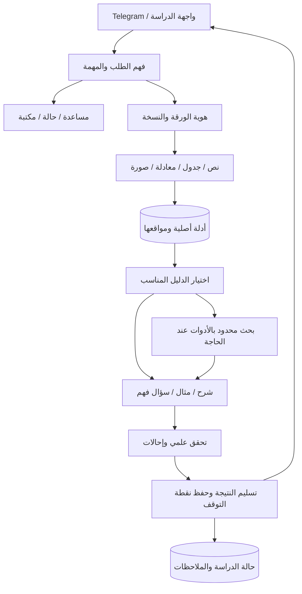

# مراجعة هندسية: ScholarLens كمساعد دائم لفهم الأبحاث

التاريخ: ٢١ أكتوبر ٢٠٢٦. المراجعة مبنية على الكود الحالي، سجلات التجربة الخاصة،
والأخطاء اللي ظهرت في Telegram. دي خارطة تطوير؛ الميزات المقترحة مش متنفذة
بمجرد وجودها هنا، ومفيش تشغيل تقييم مدفوع أو نقل استضافة ضمن المراجعة.

## الحكم الحالي

عندنا نموذج أولي يساعد في بدء قراءة ورقة، لكن لسه مش أداة يعتمد عليها الباحث
يوميًا. فيه استخلاص بنص أصلي، شرح بالمصري، إحالات، متابعة، وتخزين محدود.
في المقابل، تجربة فعلية عدّت بمقارنة أرقام خاطئة، وطلب `/deep` صحيح فشل.
نجاح اختبارات البرمجة أو صحة الاقتباس مش إثبات إن الاستنتاج العلمي صحيح.

الأولوية الحالية مسار واحد موثوق: ورقة محددة ← شرح صحيح من الدليل ← مناقشة
مركّزة ← تحقق من فهم الباحث ← حفظ نقطة التوقف والرجوع لها لاحقًا.

## رحلة الباحث المطلوبة

1. يضيف رابط/رقم/ملف الورقة ويعرف النسخة وحالة القراءة والصفحات غير المقروءة.
2. يختار هدفه: فهم سريع، دراسة الطريقة، قراءة النتائج، أو محاولة إعادة التنفيذ.
3. ياخد مقدمة قصيرة وخريطة مفاهيم ومتطلبات مسبقة؛ يختار الجزء التالي بنفسه.
4. يسأل: «ليه الخطوة دي؟»، «المعادلة بتقول إيه؟»، «إزاي أقرأ الجدول؟».
   كل إجابة تربط الادعاء بالمقطع أو المعادلة أو الخلية المقصودة.
5. يجاوب سؤال فهم أو يشرح الفكرة بطريقته، وياخد تصحيحًا مرتبطًا بنقطة ضعفه.
6. يرجع بعد أيام لنفس الورقة أو مشروعه، ويكمل من المكان اللي وقف عنده.

المصري يكون طبيعيًا ومحترمًا، والمصطلحات والأسماء والرموز العلمية تفضل واضحة.
خيار اللغة والمستوى يتغيّر صراحةً؛ سهولة الأسلوب ما تغيّرش المعنى العلمي.

## الفجوات والأولوية

| الأولوية | المطلوب | الوضع الحالي / أثر الفجوة | دليل القبول المقترح |
| --- | --- | --- | --- |
| P0 | اعتمادية الطلب وتشخيصه | `/deep` فشل بعد استدعاءين ناجحين على مستوى النقل؛ السبب الداخلي القديم غير محفوظ | إعادة إنتاج سبب الفشل أو التقاطه بتجربة محدودة، ثم نجاح كامل حتى المراجعة والتسليم |
| P0 | صحة المقارنات والأرقام | اختيار رقم موجود بالنص لم يمنع وصفه بأنه الأفضل خطأً | أسئلة ثابتة عن صف/عمود/مجموعة اختبار/وحدة، ومراجعة بشرية للادعاء والاقتباس معًا |
| P0 | فهم نية المستخدم | سؤال الإمكانيات اتعامل كطلب عن الورقة | مساعدة وأوامر حالة فورية من غير استدعاء نموذج؛ فصل أوامر التطبيق عن أسئلة المحتوى |
| P1 | دليل منظم | PDF بيتقسم لمقاطع محدودة؛ تسلسل الجدول والأعمدة ممكن يتفقد | أقسام وجداول ومعادلات وصور بعناوين ومواقع صفحات؛ إعلان النقص من غير تخمين |
| P1 | استرجاع مناسب للسؤال | اختيار محدود مع كلمات وإشارات لغوية؛ مش محرك فهم عربي متخصص للورقة | مقارنة تطوير بين اختيار المقاطع والبحث/إعادة الترتيب على أسئلة عربي وإنجليزي |
| P1 | تدريس تفاعلي | درس ثم سؤال ومتابعة عامة؛ مفيش نموذج واضح لأخطاء الفهم | تسلسل اشرح ← مثال ← محاولة من الباحث ← تغذية راجعة ← خطوة تالية |
| P1 | رسوم علمية مفيدة | الخريطة الحالية بترتب الشرح | رسم الطريقة بمكوّناتها، شرح معادلة، وقراءة جدول؛ كل عنصر علمي له مصدر |
| P2 | مكتبة وذاكرة دراسة | آخر أربعة أدوار بذاكرة حوار تنتهي بعد يوم؛ ارتباطات الأوراق محدودة | الرجوع لورقة وملاحظاتها ونقطة التوقف من غير خلط سياق ورقة أخرى |
| P2 | مقارنة أوراق | المسار التعليمي الحالي لورقة واحدة | مقارنة افتراضات وبيانات ومقاييس متوافقة، مع دليل مستقل من كل ورقة |
| P2 | مساحة دراسة ويب | Telegram مناسب للبدء والمتابعة؛ عرض PDF ورسوم تفاعلية محدود | صفحة تجمع المصدر والشرح والملاحظات والرسوم، مع Telegram كمدخل سريع |
| P3 | توفر الخدمة باستمرار | التطبيق على جهاز المستخدم؛ النوم/الإغلاق/فصل الإنترنت يوقفه | عملية استضافة مستمرة، إقلاع تلقائي، مراقبة، نسخ احتياطي واسترجاع مُجرّب |

## التصميم الهندسي المقترح

نحتفظ بـLangGraph لتنسيق خطوات واضحة قابلة للفحص. البحث الأعمق بالأدوات
يبقى قدرة محددة داخل المسار، مع حدود معروفة، بدل ما كل رسالة تحتاج خطة طويلة.
Deep Agents مناسب لما السؤال يحتاج قراءة عدة أجزاء وأدوات؛ وجوده لوحده مش
دليل على نجاح المهمة. أدواته وصلاحياته وسياقه لازم تكون متوافقة مع نموذج HF
المختار ومختبرة فعليًا. [توثيق التخصيص](https://docs.langchain.com/oss/python/deepagents/customization).

في حدود الاستدعاءات لازم نسيب مساحة للتوليد النهائي والتحقق والتسليم. السقف
الحالي أربعة استدعاءات مشتركة؛ بحث بالأدوات يستهلك السقف كله ممكن يترك
مرحلة المراجعة من غير ميزانية. معالجة ده تكون بتخطيط مراحل وسقف واضح لكل
مهمة، من غير زيادة خفية أو إعادة تشغيل استدعاء مصيره غير معروف.

MCP واجهة اختيارية لأدوات محددة: قراءة المصدر، بحث داخل المكتبة، أو تصدير
ملاحظات إلى وجهة يختارها المستخدم. إضافة أدوات ويب وNotion لها صلاحيات
وتحقق مستقل. مفيش حاجة علمية تتأكد لمجرد إن الأداة متاحة عبر MCP.

## السياق والذاكرة

نحتاج ثلاث طبقات منفصلة في مصدرها ومعناها:

- **المصدر:** نسخة الورقة، hash، صفحات، جداول، معادلات وصور. مخرجات المساعد
  والملاحظات الشخصية لا تتحول تلقائيًا لأدلة أصلية.
- **جلسة الدراسة:** الورقة والهدف والقسم الحالي وآخر سؤال ومحاولة الباحث.
  يستخدم السياق المختصر والمقاطع المطلوبة بدل إعادة إرسال المحادثة والورقة كاملة.
- **ذاكرة مستمرة:** المستوى والمصطلحات المفضلة والأوراق المحفوظة والأسئلة المفتوحة
  ونقطة التوقف. تعديلها وتصديرها وحذفها يكون واضحًا للمستخدم.

LangGraph بيفصل checkpoints الخاصة بالمحادثة عن stores للبيانات عبر المحادثات.
نختار تخزينًا دائمًا مناسبًا، ونربط كل جلسة بالباحث والورقة والنسخة. الذاكرة
الموجودة في RAM فقط مش كفاية للرجوع بعد إعادة التشغيل.
[توثيق الذاكرة والاستمرارية](https://docs.langchain.com/oss/python/langgraph/persistence).

على الجهاز الحالي، SQLite كفاية للنسخة الخاصة. عند استضافة عدة مستخدمين نقيّم
PostgreSQL ومخزن ملفات وworker للمهام الطويلة؛ ده انتقال لاحق باختبارات عزل
ونسخ احتياطي، مش إضافة مجموعة خدمات جديدة دلوقتي لمجرد الشكل المعماري.

## استراتيجية النماذج والاستخلاص

نحافظ على HF/Cerebras كخط أساس، ونغيّر النموذج بناءً على نفس مهام المقارنة.
نقيس العربي العلمي، فهم الجدول، الامتناع عند نقص الدليل، tool calling، الزمن
والتكلفة. اللهجة المناسبة لوحدها مش معيار لاختيار نموذج الشرح.

الاستخراج يبدأ بنص أصلي منظم. OCR يُستخدم عند الحاجة بعد تأهيل حقيقي للصور،
والنتائج تقاس بأخطاء المعنى: إشارة ناقص، أس في معادلة، أو تبديل عمودين.
شرح الرسوم يحتاج مصدرًا بصريًا ونموذجًا مناسبًا؛ تحويل ملخص إلى أسهم ما يغنيش
عن قراءة الشكل الحقيقي. حالة OCR وNotion الحالية تفضل معلنة بوضوح.

## اختبارات المنتج قبل الاعتماد عليه

اختبارات البرمجة الحالية مهمة للعزل والحدود والتكرار وحفظ الحالة، لكن لازم
يضاف لها تقييم منفصل لمهام الباحث. QASPER مثال بحثي لأسئلة عن أوراق مع أدلة
داعمة؛ نستلهم منه بناء التقييم، مع إضافة العربي والتدريس والجداول. هو مش
تقييم جاهز للمصري أو لـOCR. [ورقة QASPER](https://arxiv.org/abs/2105.03011).

نجهز مجموعة تطوير متنوعة وأسئلة حقيقية، ومجموعة جديدة لا نعدّل الـprompt
عليها. نقيس: صحة الادعاء ودليله، اختيار البيانات/الوحدة، الإجابة أو الامتناع
في موضعه، جودة المصري، فائدة التغذية الراجعة، نجاح الرجوع لجلسة قديمة،
إتمام المهمة، زمنها وعدد استدعاءاتها. النتائج تشمل الحالات الفاشلة.

النجاح التعليمي يتقاس بقدرة الباحث إنه يشرح الطريقة ويقرأ نتيجة ويحدد قيدًا
في الورقة، مش بمجرد طول الإجابة أو وجود مراجع. حدود القبول العددية تتثبت
مع مجموعة التقييم قبل تشغيلها. لا يوجد تمويل أو تشغيل لهذه المجموعة هنا.

## ترتيب التنفيذ

1. **تثبيت الأساس:** تشخيص `/deep` وتأهيل مسار كامل، مساعدة فورية، وتصنيف
   الأخطاء. عدم اعتبار تحسين الـprompt وحده إصلاحًا مثبتًا للفشل الحي.
2. **تعليم ورقة واحدة جيدًا:** دليل منظم، شرح النتائج بوحداتها، قراءة شكل
   ومعادلة، ومناقشة متدرجة مع تقييم فهم وملاحظات.
3. **استمرارية البحث:** مكتبة أوراق، استئناف دراسة، أسئلة مفتوحة، ثم مقارنة
   ورقتين بعد إثبات إن استرجاع الدليل من كل واحدة صحيح.
4. **تجربة دائمة:** واجهة دراسة أوسع واستضافة مستمرة إذا كان المطلوب24/7،
   مع قياس موارد وتكلفة ومراقبة واسترجاع. تبقى النسخة الخاصة على جهازك متاحة
   أثناء ذلك، حسب توفر الجهاز والإنترنت.

أول ما نحتاجه من المالك لاحقًا: تجربة دراسة ورقة فعلية وتحديد أين اتوقف الفهم؛
تفضيل عربي/مصري ومستوى؛ وهل الأولوية معادلات/رسوم أم مكتبة ومتابعة. أي تجربة
نموذج مدفوعة جديدة لها نطاق وسقف منفصل، لأن سقف الفحص القديم12/12 انتهى.
