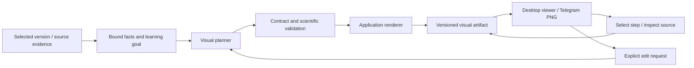

# learning-visuals: source-grounded visual teaching

Status: proposed implementation specification, 21 October 2026. This extends the
existing `learning-visuals` capability in [the map](../../CAPABILITY_MAP.md).
Research/plan only in this change; no live model or app behavior is activated.
[Research and model decision](../research/visual-learning-20261021/DECISIONS.md).

## Outcome and first slice

An Egyptian researcher can inspect a paper method as a diagram, advance through
its steps, reveal what each component means and inspect its original evidence.
The artifact distinguishes reported facts from an illustrative teaching example.
Changing the selected step does not call a model again.

The first implementation is an **offline RAG method prototype** with curated,
source-bound facts for `2005.11401v4`. It has separate training/inference views.
It produces SVG/PNG and a local desktop viewer before any new model integration.
It is not presented as arbitrary-paper visualization or a Telegram Mini App.

Source fixture identity: PDF SHA256
`23e3249e9a1e75418d82efecab0ea8c4d033b89c93742f63208d47ce01f21233`,
parser `pdfium-5.14.0-v1`. Training evidence includes page 4 block `p4b0`.
Facts must be reviewed against section 2.4, not inferred from the old generated
lesson: query encoder/BART are updated; document encoder/index remain fixed.
[Source paper](https://arxiv.org/pdf/2005.11401v4).

## Architecture and boundaries



Source analyst, teaching planner, renderer and critic are logical workflow roles.
Initial execution is sequential with deterministic transitions, not a new swarm
of parallel model processes. The renderer takes data, not model-generated code.
Deep Agents is optional for later evidence collection; its unresolved failure
does not block the offline visual contract/rendering work.

The existing `visuals.py` reading map remains available. New source is proposed
under `src/services/study/visual_learning/`; do not turn the current map renderer
into a general code executor or add unrelated logic to the main service.

## Contracts

**EvidenceFact** comes from a reviewed source manifest or later qualified source
analysis. It carries a fact ID, canonical paper/version, PDF hash, parser revision,
block/page/region references, statement, origin and verification status. Merely
having a valid ID does not establish semantic correctness.

**VisualSpec.v1** contains:

- Paper identity/hash and an explicit learning goal/depth/language.
- A supported template type; initially only `method_flow`.
- At most12 nodes, 24 typed edges and 8 steps; these are proposed new feature caps,
  not modifications of existing runtime limits.
- Nodes with stable IDs, Arabic labels/explanations, origin and fact references.
- Edges with endpoints, phase and relation type such as data flow, parameter
  update or reading order. Cycles are allowed only when the reviewed mechanism
  calls for them; scientific graphs are not assumed to be acyclic.
- Ordered steps with highlighted components, a teaching explanation and an
  optional comprehension question. Controls are a fixed application enum.
- An explicit teaching-example label wherever hypothetical data/mechanisms appear.

Reject unknown keys/IDs/endpoints, paper/hash mismatch and an unsupported template.
Paper-specific nodes and edges require bound source facts. Scientific review
checks labels, edge meanings and missing qualifications, not just geometry.
No arbitrary HTML/SVG/JS/URLs, shell commands or renderer parameters are accepted.
The planner's JSON limit starts at 16 KiB; finalize tested caps during implementation.

**VisualArtifact** adds server-owned ID/owner, artifact version, parent version,
spec digest, source/template/prompt/model revisions, review result and asset hashes.
Owner and filesystem paths never come from the model. Keep generated explanation
separate from primary evidence. Cache by semantic spec/source/revision, not just
paper title. An edit preserves previous accepted versions and explicitly locked facts.

Later**VerifiedTableCell** includes table/row/column, dataset, split, metric,
unit and printed value with provenance. A chart refers to these IDs; the renderer
copies values. It cannot generate numbers from a plausible-looking model table.
Initial method-flow validation does not claim to implement charts or equations.

## Interaction and delivery

The proposed user command is `/visual method` after selecting a paper. The first
prototype can be exercised locally without adding that command to the live bot.

The desktop viewer has next/previous, component selection, source inspection,
training/inference switch and a text alternative. It is an application-authored
HTML/SVG shell with data from the artifact. Embed no API key or model credentials.
It can be opened locally on this PC; it is not a phone-accessible loopback service.

Telegram later receives PNG and fixed text actions. Existing polling currently
accepts message updates, not a new callback-query protocol. Reuse validated
owner/private-chat text actions first; if inline callbacks are added later,
specify and test their authentication/update/replay handling separately.

Deterministic step actions should use a separate authenticated visual-actions
contract with the existing request quota. Keep generation quotas on generation
admission. Today `/study/messages` charges that quota even for commands; sending
every next/previous through that path would rate-limit a model-free walkthrough.
Do not relax or relabel existing endpoints to bypass their current limits.

Future visual-generation jobs share durable admission, reserve-before-outbound
attempts, cancellation/recovery and owner gates. Deterministic controls are not
new paid jobs. No automatic inference is triggered by opening or navigating a view.

A Telegram Mini App is a later delivery slice requiring a phone-reachable HTTPS
deployment and server-validated Telegram initialization data. It does not inherit
authorization from the desktop Codex app. No public tunnel or deployment is part
of the first implementation.[Telegram protocol](https://core.telegram.org/bots/webapps).

## Renderer, Arabic and resources

Serialize approved SVG primitives from the validated scene. Labels use text
escaping and fixed fonts/layout. No external resources, scripts, foreignObject,
event-handler attributes or embedded arbitrary SVG are permitted. Bind controls
in trusted application code outside untrusted labels.

Use the existing Pillow/Arabic-shaping path and Windows fixed drawing worker
for PNG where feasible. Both exports derive from the same scene. Paginate or
expand a diagram rather than shrinking Arabic below a readable size. Verify RTL,
mixed English terms, arrows, contrast, labels, keyboard use and reduced motion.

The first prototype adds no local model weights, new hosted service, daemon or
browser to normal bot startup. Browser tooling may be used for development QA.
Measure later render workers separately and preserve the current startup/live
RAM floors. Pin any new renderer/chart dependency in its own reviewed slice.

## Model and prompt integration after the offline slice

Keep the current GPT-OSS/Cerebras path as text-planning baseline. Kimi K3 and
Qwen are unqualified comparison candidates, not automatic replacements. The
current fixed Cerebras transport/tokenizer/reasoning settings are not a generic
Kimi client; add an isolated capability-aware adapter if that candidate qualifies.

Planner input: selected paper identity, task, explicit learner preferences,
bounded evidence/fact catalog, accepted prior spec and focused edit request.
Source and prior dialogue are untrusted data. Output only `VisualSpec` fields.
Preserve locked source facts, label examples, avoid invented numbers and show
missing evidence explicitly. Keep training and inference mechanisms distinct.

Critic input: the proposed spec, source facts/full relevant context and rubric.
Return bounded accept/reject categories for unsupported claims, wrong edge
meaning, granularity, unit/split mismatches and missing labels. A later vision
critic can inspect a screenshot, but cannot override a source-data failure.

First qualified text workflow targets one planning call and one review call;
rejection stops. Any future repair loop must reserve another review slot. Never
deliver an unchecked repair or consume a final review's budget during planning.
Live experiments need their own explicit scope/ceiling; none is granted here.

## Acceptance and verification

First prototype is complete when:

1. RAG training/inference diagrams match the reviewed facts and expose references;
   wrong update arrows, source hashes or cross-paper IDs fail validation.
2. Arabic SVG/PNG are legible and local viewer steps work with mouse/keyboard;
   source inspection and navigation perform zero network/model requests.
3. Malicious labels are inert; owner/source boundaries, versions and export data
   contain no credentials. Changes preserve the previous accepted artifact.

Later model acceptance uses the same fixtures for all candidates: schema validity,
scientific facts/edges, source coverage, Egyptian terminology, interactive task
success, preservation during edits, total latency, peak RAM and attempted calls.
Evaluate method, comparison, equation and numeric-chart tasks separately. Use a
fresh holdout for scientific/learning claims, not the tuned RAG fixture alone.

Proposed focused commands once test files exist:

```powershell
.venv-win/Scripts/python.exe -m pytest tests/unit/test_visual_contract.py tests/unit/test_visual_renderer.py -q -o cache_dir=tests/test_output/visual-pytest --basetemp tests/test_output/visual-first
.venv-win/Scripts/python.exe -m ruff check src tests research
.venv-win/Scripts/python.exe -m mypy src
```

Create the base-temp parent and choose a fresh directory. Rendering/browser QA
must inspect actual exports at desktop and narrow widths with console/network
checks. These commands describe future verification; they were not run against
nonexistent implementation files during this planning change.
