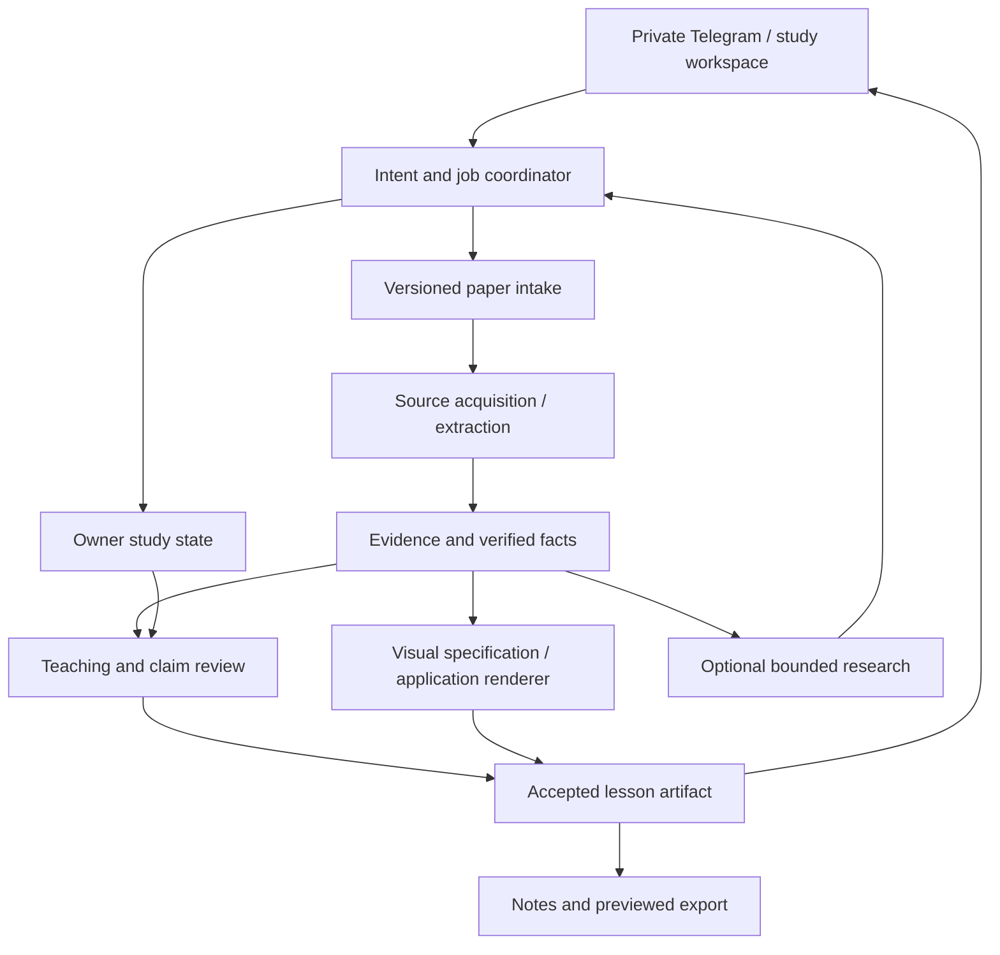

# ScholarLens: whole researcher-learning implementation

Status: proposed, reviewable specification set. Date: 21 October 2026.
Branch: `codex/visual-learning`; application source baseline: `1bf7c9a`.
The owner requested the complete map, specs and plan in this turn; this document
does not claim implementation or authorize new paid calls. It extends the
[17 October implemented contract](paper-learning.md), preserves the nine module
IDs in [CAPABILITY_MAP](../../CAPABILITY_MAP.md), and links the
[execution plan](../../tasks/plan.md#whole-app-implementation--21-october-2026).

## Objective and user journey

Help an Egyptian researcher understand a selected AI paper, inspect the evidence,
practice explaining the mechanism and return later to continue studying it.
The initial user remains the paired private Telegram owner on their current PC.
HF-hosted reasoning and LangGraph remain the baseline. Weekly paper discovery,
public multi-user access, autonomous code execution and fine-tuning are outside
the initial learning release.

The researcher supplies an arXiv URL/ID/title, selects an explicit version,
chooses an optional goal/depth, receives a short cited orientation, explores a
method/table/equation, attempts a comprehension question, receives grounded
feedback and saves a study position. They can inspect what was unreadable,
switch papers without losing saved progress, and delete their study data.

Defaults: Egyptian Arabic with searchable English terminology; beginner/researcher
depth kept from current preferences; source-backed paper claims, explicitly
labeled background/examples, no mandatory onboarding questionnaire. Use
[the Arabic/English reading contract](arabic-reading.md) across all surfaces.
Preserve the owner's existing general AI/ML concept mode and legacy cited-paper
endpoints. General model knowledge stays labeled as such and cannot silently
substitute for a claim about the selected paper.

## Specification index and release scope

| Module | Contract | First useful extension |
| --- | --- | --- |
| `paper-intake` | [Intake](paper-intake.md) | Reliable identity and clear unsupported-source handling |
| `paper-content` | [Content](paper-content.md) | Structured source regions and qualified page OCR |
| `paper-evidence` | [Evidence](paper-evidence.md) | Claim support and compatible numeric comparisons |
| `learning-session` | [Session](learning-session.md) | Durable goals/progress, library and deletion |
| `paper-tutor` | [Tutor](paper-tutor.md) | Explain → attempt → feedback → next step |
| `learning-visuals` | [Visuals](learning-visuals.md) | Offline RAG mechanism viewer, then general-paper plans |
| `study-research` | [Research](study-research.md) | Diagnose Deep, preserve final review budget |
| `learning-delivery` | [Delivery](learning-delivery.md) | Deterministic navigation, clear states, rich workspace |
| `study-notes` | [Notes](study-notes.md) | Editable source-linked notes and previewed export |

R1 is the private daily-study release: reliable native-text paper flow, checked
claims, interactive teaching, durable progress, the qualified method-visual path,
RTL and notes. A curated RAG prototype alone does not satisfy general-paper
visual support; it is an earlier offline milestone. Deep may remain explicitly
experimental until its separate end-to-end qualification passes.

R2 adds reviewed source regions, OCR, table/equation/figure teaching and their
visuals. These capabilities remain unavailable on unsupported content rather
than returning guessed structure. R3 adds bounded multi-paper comparison,
external primary-source research, optional Notion export and the rich study
workspace. R4 is hosted private availability/Mini App, followed only after a
separate decision by public/multi-user access. R1 must work without R2/R3 services.

## Architecture and ownership



Arrows show runtime data/control flow, not the acyclic module dependencies in
the capability map. Keep the current application, SQLite and isolated workers;
do not introduce microservices or a graph database for these modules. One
coordinator calls providers and accepts immutable reports; providers never call
delivery adapters. Logical source/planner/renderer/critic roles do not require
four concurrent models. [LangGraph workflow patterns](https://docs.langchain.com/oss/python/langgraph/workflows-agents).

Application SQLite remains the authority for owner, intents, attempts, accepted
artifacts and deletion. A future LangGraph checkpointer may store execution
progress; it must not duplicate charging authority or resume an uncertain model
request. Thread checkpoints and long-term stores serve different scopes.
Avoid installing a new checkpointer until its need and failure semantics are
tested. [Persistence concepts](https://docs.langchain.com/oss/python/langgraph/persistence).

## Model, prompt, context and tool policy

| Role | Initial choice | Qualification needed |
| --- | --- | --- |
| Teaching/text visual planning | Current `openai/gpt-oss-120b:cerebras` via HF | Source accuracy, Egyptian teaching, schema and task completion |
| Vision/visual review | Kimi K3 and Qwen candidates from the saved research | Actual provider image/schema/tool support, scientific quality and terms |
| OCR | Disabled OCR-2 adapter plus newer alternatives in saved research | Page-level scientific extraction, regions, availability and resource cost |
| Rendering/navigation | Application-owned templates and typed actions | Scientific geometry, RTL, safety and zero inference on navigation |

No provider change is chosen from a marketing benchmark. Recheck exact routes,
model revisions, licenses, tokenizer/context rules, structured output, tool
history, usage accounting and errors before qualification. Catalog `live` is
availability evidence only. Do not transfer fixed Cerebras reasoning/tokenizer
settings to Kimi. Use identical tasks and keep failures in each comparison.
[Saved model research](../research/visual-learning-20261021/DECISIONS.md),
[extraction candidates](../research/paper-learning-20261017/DECISIONS.md),
[HF structured output](https://huggingface.co/docs/inference-providers/guides/structured-output).

Prompt contracts keep immutable instructions, requested learning action, explicit
preferences, selected version, bounded source facts, recent dialogue and optional
research in separate fields. Sources/dialogue/tool outputs are untrusted data.
No assistant answer or inferred learner weakness becomes primary evidence.
Version/hash prompts and schemas; retain the source/model/prompt revisions of
accepted artifacts. Prompt changes receive the same science regression checks
as code changes; an LLM critic is evidence to evaluate, not a truth guarantee.

Current jobs keep `max_calls=4`, one active study generation at a time. New
planning must reserve final answer/review capacity before tool exploration. A
candidate Deep schedule allocates at most two model calls for research and one
each for synthesis/review, sharing the same four-attempt total. If that schedule
cannot complete a question, stop with a useful bounded status; do not increase
the cap or send an unchecked repair. Keep eight read-only tool operations as
the initial Deep tool limit. Retries, failures and unknown outcomes count.

Developer-initiated experiments need an applicable explicit scope and ceiling.
The pending [eight-call Deep plan](../deep-repair-execution-20261021.md) is not
approved and cannot fund visuals/OCR. Historic evaluation grants and the 12/12
smoke ceiling remain closed. Ordinary owner-triggered app requests retain their
existing admission. Viewing, copying, selecting steps and loading saved notes
must not generate new paid work.

## Runtime, storage and availability

Preserve startup/live host-memory admission (1,024/600 MiB), current parser size/
page/deadline limits and source cache cap. Profile before changing any limit.
Use lazy imports, one bounded parsing/rendering task, streaming downloads and
short-lived workers; optional SDK stays in its separate environment. No local
LLM/OCR weights, always-running browser, OpenSearch or Docker is required by the
new selected-paper path. The legacy indexed-paper route retains its own needs.

On memory or provider failure, keep accepted text/source available and show a
finite recoverable state. Do not promise that a sleeping/offline PC is an
always-available service. Hosted private operation requires an explicit host,
cost and credential plan, supervised worker, health monitoring, backup/restore
and safe Telegram polling ownership before moving traffic.

New owner artifacts get a separately versioned store with bounded disk quotas;
additive migrations get a backup/restore test. Do not rewrite old evaluation
ledgers or migrate the production corpus. `/forget` must cover all newly added
personal state; retained anonymous source caches and delivery tombstones require
an explicit documented distinction. Deletion cannot re-enable old paid intents.

## Interfaces, failure states and security

Module specs own their provided types. Versioned identity is carried through
every artifact; owner/paths/authorization come from trusted configuration. Strict
new contracts reject unknown fields and invalid/cross-paper references. Source
quotations are copied by the server; generated output supplies IDs. Optional
integrations are explicitly unavailable when unconfigured.

Keep existing `/api/v1/study/messages`, `/pending`, `/claim` behavior stable.
Add separate authenticated action/artifact routes for model-free navigation;
retain existing generation quotas rather than reclassifying the old endpoint.
State-changing requests bind one intent to one payload hash with atomic
uniqueness. Duplicate in-flight work returns its pending state; a changed
payload conflicts. Unknown external outcomes are never silently replayed.
Telegram send uncertainty must not be described as exactly-once delivery.

User-facing states: selection needed, admitted, extracting, teaching, reviewing,
ready, partial coverage, unsupported, resource unavailable, failed, interrupted
and cancelled where supported. Only announce a stage actually entered; every
terminal state has a readable next action and a safe support ID. Log finite
failure/stage codes, timings, source hashes and call counts; no raw reasoning,
credentials or full dialogue. New APIs use the repository's HTTPException detail
pattern with bounded machine codes; do not expose arbitrary provider exceptions.

Untrusted PDFs/HTML/prompts never grant tool access. MCP exposes named bounded
tools; no arbitrary shell, unrestricted filesystem, dynamic server installation
or arbitrary URL fetch. New public-source URLs need an explicit fetch policy.
Notion writes require an application-owned connection and an explicit destination
action; a Codex connector does not grant the running bot access.

## Engineering baseline and executable checks

Python 3.12; FastAPI/Pydantic; pinned LangGraph 1.2.15, PDFium 5.14.0 and Pillow
12.3.0 from `pyproject.toml`/`uv.lock`. Keep optional Deep Agents/MCP dependencies
in `research/requirements.lock` and `.venv-study-research`; no blanket upgrades.
Use existing strict Pydantic style, typed enums, injected HTTP/clock boundaries
and small modules. Example style from `content.py`:

```python
class EvidenceBlock(BaseModel):
    model_config = ConfigDict(extra="forbid", strict=True)
    id: str = Field(pattern=r"^(?:p\d+b\d+|abstract\d+)$", max_length=32)
```

Code: `src/services/study/`; CLI: `src/commands/`; isolated SDK tests:
`research/tests/`; ordinary tests: `tests/unit/` and `tests/api/`; reviewed data:
`evaluation/`; primary research/specs: `docs/`; generated proof: ignored
`tests/test_output/`; private state: ignored `data/`. Proposed paths in task
records are targets, not claims that those files exist today.

```powershell
# Existing baseline checks; choose a fresh, not previously used basetemp.
New-Item -ItemType Directory -Force -Path tests/test_output | Out-Null
.venv-win/Scripts/python.exe -m pytest tests/unit/test_study_intake.py tests/unit/test_study_content.py tests/unit/test_study_service.py -q -o cache_dir=tests/test_output/study-pytest --basetemp tests/test_output/researcher-baseline
.venv-win/Scripts/python.exe -m ruff check src tests research
.venv-win/Scripts/python.exe -m mypy src
.venv-study-research/Scripts/python.exe -m unittest discover -s research/tests -v
# Broader regression at an implementation checkpoint, after focused checks.
.venv-win/Scripts/python.exe -m pytest tests/unit tests/api -q -o cache_dir=tests/test_output/study-pytest --basetemp tests/test_output/researcher-release
# Only when intentionally testing startup; these commands start/restart the bot.
.\Telegram.ps1
.\Telegram.ps1 -Restart
```

No application tests/startup commands are run merely to publish this plan.
Task-specific future tests must exist before their documented command is used.
Every implementation task targets at most five source/test files; split it when
it grows. Review the actual diff, maintain meaningful tests and keep evidence
dated to the tested source. No test deletion/suppression or weaker gate to pass.

## Acceptance and release evidence

The following are proposed gates, not achieved scores or general guarantees:

- Contract/security/regression cases pass, including two-owner isolation,
  deletion, replay, interruption, wrong source/version and exhausted budget.
- Scientific fixture cases have zero accepted critical errors: wrong best result,
  units/splits, training updates, equation signs or token/paragraph mechanism.
- Before claiming a release-quality tutor, freeze a 12-paper/48-question holdout,
  distinct from development RAG, with native/scanned/multicolumn sources and
  supported/unanswerable questions. R1 scores native-text tasks only; R2 scores
  the added extraction tasks. Report per-capability denominators and failures.
- Proposed human review gate: zero critical scientific errors, at least 90% of
  paper claims correctly supported, and at least 80% of answerable cases useful;
  two reviewers give median Egyptian clarity/teaching at least 4/5. Freeze the
  rubric before generation and retain disagreements; missing reviewers means
  provisional private acceptance, not a completed scientific evaluation.
- Visual/RTL acceptance includes all twelve mixed-text cases, source inspection,
  desktop/narrow/zoomed layouts, keyboard/copy and no navigation inference.
- Target local control feedback under 200 ms at p95 over 100 cached interactions
  on the declared test PC; record actual cold/warm latency, peak RAM and remote
  job durations. This is a future measurement target, not a current benchmark.
- New generation jobs finish in a documented terminal state, keep final review
  capacity and preserve accepted prior artifacts; process restart never creates
  an extra external request for the same uncertain attempt.

Human learning gains require a separate consented study; do not equate good
lesson ratings or a tuned fixture with proven comprehension improvement.
R4 additionally requires tested restoration and private phone access. Public
availability is a separate release with multi-user identity, quotas and privacy.

Always: preserve identity, source truth, owner scope, budgets and tested limits.
Decide with the owner before incurring new hosted/model costs, sending developer
test messages, enabling external writes, moving traffic or deleting existing
user/corpus data. Routine reversible implementation and additive local work
within these contracts do not need repeated permission. Never commit secrets,
execute model-supplied code or silently reset/reuse attempt grants.

## Deferred decisions

Provider/OCR selection follows qualification; no untested replacement is assumed.
Notion destination/connection, hosted budget/domain, future public users and
whether to retain study progress beyond the current 30-day policy are collected
at the end of the plan. Keep current retention until explicitly changed. These
choices do not block the offline RAG/RTL or source-contract slices.
